# Evaluación Parcial N°2 — Machine Learning
## Caso C: Inteligencia musical y predicción de popularidad de canciones

### Integrantes
- Joaquin Muñoz
- Carlos Acevedo
- Jean Bizama

## Introducción

Las plataformas de streaming reciben miles de canciones nuevas cada día y los sellos
discográficos deben decidir, con presupuesto limitado, cuáles impulsar. Hoy esa decisión
se apoya sobre todo en criterio editorial. Este proyecto evalúa si un modelo de Machine
Learning puede aportar un filtro cuantitativo previo, estimando la **popularidad** de una
canción de Spotify a partir de sus características musicales y su género.

Este informe corresponde a la **segunda entrega** y continúa el trabajo de la primera
(EP1), que cubrió la comprensión del negocio, la exploración de los datos y su limpieza.
Aquí se completa el ciclo: se construyen **dos modelos supervisados de regresión** y se
aplica **una técnica no supervisada** (clustering) para descubrir segmentos dentro del
catálogo. Luego se evalúan con métricas apropiadas y se traducen en recomendaciones
para el negocio.

Como este es un informe independiente, se retoma lo esencial de la EP1 y se resumen sus
hallazgos, que condicionan todas las decisiones posteriores:

| Hallazgo de la EP1 | Consecuencia para esta entrega |
|---|---|
| 114.000 filas, pero solo 88.732 canciones distintas: una misma canción aparece en varios géneros | Se trabaja con una fila por canción (track_id) |
| Hay 6.666 canciones con el mismo nombre, artista y duración pero distinto track_id | La validación se hace por grupos (id_contenido) para evitar fuga de datos |
| popularity = 0 se concentra en ciertos géneros: es dato faltante, no impopularidad | Esas 9.313 canciones se excluyen del modelado y se declara como limitación |
| Ninguna característica de audio supera \|r\| = 0,10 con la popularidad; el género explica ~25% de la varianza | Se espera que el género pese más que el audio y se mide de forma explícita |
| Predecir la media del género da un MAE de ~9,76 (vs. 15,15 con la media global) | Es la línea base que cualquier modelo debe superar |

### Estructura del informe

| Sección | Contenido |
|---|---|
| 1 | Problema de negocio, objetivos, KPIs, fuentes de datos, herramientas y metodología |
| 2 | Análisis exploratorio de los datos |
| 3 | Preparación y transformación de los datos |
| 4 | Modelos supervisados (regresión) |
| 5 | Modelo no supervisado (clustering) |
| 6 | Evaluación y comparación de resultados |
| 7 | Sesgos, ética y privacidad |
| 8 | Conclusiones y recomendaciones |

## 1. Problema de negocio, objetivos y KPIs

### 1.1 Descripción del problema de negocio

En la industria musical se publica diariamente una gran cantidad de canciones en las
plataformas de streaming, pero no todas alcanzan el mismo nivel de popularidad. Los
sellos discográficos y las plataformas deben decidir con presupuesto limitado qué
canciones de su catálogo impulsar mediante listas editoriales y campañas de promoción,
y hoy esa selección se apoya principalmente en criterio editorial, sin un filtro
cuantitativo previo.

El problema de negocio es de **priorización**: identificar anticipadamente, entre miles
de canciones, cuáles presentan características asociadas a un potencial de popularidad
superior al esperable dentro de su género.

Se plantea desde dos ángulos complementarios:

- **Predictivo (aprendizaje supervisado):** estimar cuántos puntos de popularidad
  (0 a 100) alcanzaría una canción, para ordenar el catálogo y decidir dónde invertir.
- **Descriptivo (aprendizaje no supervisado):** descubrir segmentos naturales de canciones
  según su perfil sonoro, para que el negocio defina estrategias distintas por tipo
  de repertorio en lugar de tratar todo el catálogo como uno solo.

### 1.2 Objetivos del proyecto

**Objetivo general**

Desarrollar y comparar modelos de Machine Learning supervisados y no supervisados que
estimen la popularidad de canciones de Spotify y revelen segmentos del catálogo, a
partir de sus características musicales y su género, para apoyar decisiones de
priorización.

**Objetivos específicos**

- Resumir la comprensión y calidad de los datos heredadas de la EP1 y verificar que el
  conjunto preparado sea consistente.
- Preparar los datos para el modelamiento, evitando la fuga de información entre
  entrenamiento y prueba.
- Construir y comparar **dos modelos supervisados de regresión**, justificando la
  elección del algoritmo y su configuración.
- Aplicar **una técnica no supervisada** para identificar segmentos de canciones e
  interpretar su relación con la popularidad y el género.
- Evaluar los modelos con métricas apropiadas, **por género y no solo en promedio**, y
  contrastarlos con la línea base.
- Traducir los resultados en recomendaciones de negocio, indicando también los límites
  de uso de la solución.

### 1.3 KPIs

La variable popularity es el indicador central del proyecto. Se mantienen los KPIs
definidos en la EP1, para poder evaluar si el modelamiento cumplió lo comprometido:

| KPI | Definición | Cómo se mide | Meta |
|---|---|---|---|
| Precisión en priorización | % de canciones que el modelo ubica en el 10% superior de su género y que efectivamente lo están | Precision@10% por género | ≥ 40% |
| Reducción del error de estimación | Baja del error promedio respecto de predecir el promedio del género | MAE del modelo vs. MAE de la línea base | ≥ 20% de mejora |
| Cobertura del catálogo | % de canciones sobre las que el modelo puede pronunciarse | Canciones modelables / canciones únicas del catálogo | ≥ 85% |
| Equidad entre géneros | Diferencia de error entre el género mejor y peor estimado | MAE máximo − MAE mínimo por género | ≤ 8 puntos |

Además de los KPIs de negocio, se usarán métricas técnicas para comparar los modelos:

| Tipo de modelo | Métricas técnicas |
|---|---|
| Supervisado (regresión) | MAE, RMSE y R², calculados con validación cruzada agrupada |
| No supervisado (clustering) | Coeficiente de silueta, método del codo (inercia) y perfil de cada segmento |

### 1.4 Justificación de las metas

Las metas se derivan de líneas base calculadas sobre los propios datos, no de supuestos.
Predecir el promedio global del catálogo da un error medio de unos 15 puntos; predecir
el promedio del género correspondiente lo reduce a unos 9,8, una mejora cercana al 35%
sin usar ninguna característica de audio. Esa es la línea base real que cualquier modelo
debe superar, y por eso el KPI de reducción del error se fija sobre ella y no sobre la
media global (la sección 1.8 calcula ambas cifras).

El KPI de equidad responde a un hallazgo de la exploración: los datos faltantes de
popularidad se concentran en géneros específicos, por lo que un modelo podría funcionar
bien en promedio y ser inservible para jazz o música latina. Un indicador agregado
ocultaría ese problema, por eso el error se reporta por género.

Las metas **no se modifican después de ver los resultados**: la sección 6 informa con
honestidad cuáles se cumplieron y cuáles no, y explica las causas.

### 1.5 Fuentes de datos

El proyecto usa el *Spotify Tracks Dataset* (CSV), construido a partir de la API de
Spotify, y dos archivos derivados que se generaron en la EP1:

| Archivo | Filas × columnas | Descripción |
|---|---|---|
| Spotify_Tracks_Dataset.csv | 114.000 × 21 | Dataset original: 114 géneros, 1.000 canciones por género. Una canción puede repetirse en varios géneros |
| spotify_modelable.csv | 79.419 × 27 | Una fila por canción, con popularity > 0, valores imposibles eliminados y variables derivadas. Es el insumo del modelamiento |
| spotify_excluidas_pop0.csv | 9.313 × 22 | Canciones con popularity = 0, tratadas como dato faltante y excluidas del entrenamiento |

Variables principales del conjunto modelable:

| Grupo | Columnas |
|---|---|
| Variable objetivo | popularity (índice de 0 a 100 calculado por Spotify) |
| Características de audio | danceability, energy, loudness, speechiness, acousticness, instrumentalness, liveness, valence, tempo |
| Características de la pista | duration_ms, key, mode, time_signature, explicit |
| Género | generos (todas las etiquetas), n_generos, genero_principal (el más específico) |
| Derivadas | duration_min, duration_log, es_instrumental, es_vivo |
| Control de fuga de datos | id_contenido (agrupa copias de una misma canción con distinto track_id) |

Las definiciones de las características de audio provienen de la documentación oficial
de la API de Spotify.

### 1.6 Herramientas utilizadas

| Herramienta | Uso en el proyecto |
|---|---|
| Python 3 | Lenguaje base del análisis |
| pandas / numpy | Manipulación, limpieza y transformación de datos |
| matplotlib / seaborn | Visualización de la exploración y de los resultados |
| scikit-learn | Modelos supervisados, clustering, validación cruzada y métricas |
| joblib | Guardado del modelo entrenado en "models/" |
| Git / GitHub | Control de versiones y trabajo colaborativo del equipo |

### 1.7 Metodología: CRISP-DM

El proyecto sigue la metodología **CRISP-DM** (*Cross-Industry Standard Process for Data
Mining*), que organiza el trabajo en fases iterativas. La EP1 cubrió las tres primeras
y esta entrega las completa:

| Fase CRISP-DM | Qué se hace en este proyecto | Sección |
|---|---|---|
| 1. Comprensión del negocio | Problema de priorización, objetivos y KPIs con metas numéricas | 1 |
| 2. Comprensión de los datos | Calidad, duplicados, ceros en popularity, valores atípicos y relación con la variable objetivo | 2 |
| 3. Preparación de los datos | Una fila por canción, selección y transformación de variables, partición agrupada | 3 |
| 4. Modelado | Dos modelos supervisados de regresión y un modelo no supervisado (clustering) | 4 y 5 |
| 5. Evaluación | Métricas técnicas y KPIs de negocio, también por género; límites de la solución | 6 y 7 |
| 6. Despliegue | Modelo guardado, recomendaciones de uso y trabajo futuro | 8 |

### 1.8 Verificación de los insumos y línea base

Antes de avanzar, se comprueba que los tres archivos existan en "data/", que sus
dimensiones coincidan con lo documentado en la EP1 y que la línea base de los KPIs
se reproduzca con los datos actuales.

La línea base se reproduce con los datos actuales: predecir la media global da un error de
unos 15,1 puntos y predecir la media del género lo baja a unos 9,8, sin usar ninguna
característica de audio. Para cumplir el KPI de reducción de error, un modelo debería
bajar de 9,8 a unos **7,8 puntos de MAE**. La cobertura del catálogo ya es de **89,5%**,
por encima de la meta de 85%, porque solo se excluyen las canciones con popularity = 0.

Esta línea base se calculó sobre todos los datos; en la sección 4 se recalculará con
validación cruzada, para comparar a los modelos y a la línea base en igualdad de condiciones.

## 2. Análisis exploratorio de los datos (EDA)

La EP1 hizo la exploración sobre los 114.000 registros originales. Aquí se repite sobre el conjunto **modelable** (79.419 canciones, una por track_id, sin popularity = 0), porque es el que realmente alimenta a los modelos. El objetivo no es repetir gráficos, sino responder tres preguntas que deciden el modelamiento:

1. ¿Cómo se distribuye la variable objetivo y qué error es "esperable"?
2. ¿Cuánto explican el género y el audio, y qué relación tienen con la popularidad (lineal o no)?
3. ¿Qué problemas de los datos pueden afectar a los modelos (desbalance de géneros, colinealidad, valores bajos sospechosos)?

|  | popularity |
|---|---|
| count | 79419.00 |
| mean | 37.14 |
| std | 18.15 |
| min | 1.00 |
| 25% | 22.00 |
| 50% | 37.00 |
| 75% | 50.00 |
| max | 100.00 |

### 2.1 Distribución de la variable objetivo

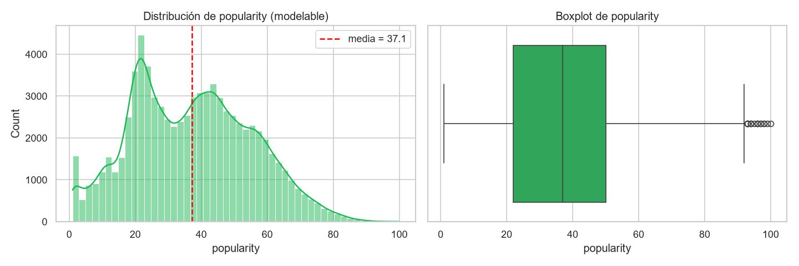

*Figura 1. Distribución de popularity (canciones modelables) y su boxplot.*

La distribución es amplia (desviación estándar de unos 18 puntos) y casi simétrica, sin una cola extrema que obligue a transformar la variable objetivo. Por eso se modela popularity directamente y se usan **MAE** (error típico en puntos, fácil de explicar al negocio) y **RMSE** (castiga más los errores grandes). Se nota además un pico de canciones con valores muy bajos (1 y 2), que se estudia en el punto 2.5.

### 2.2 El género como variable dominante

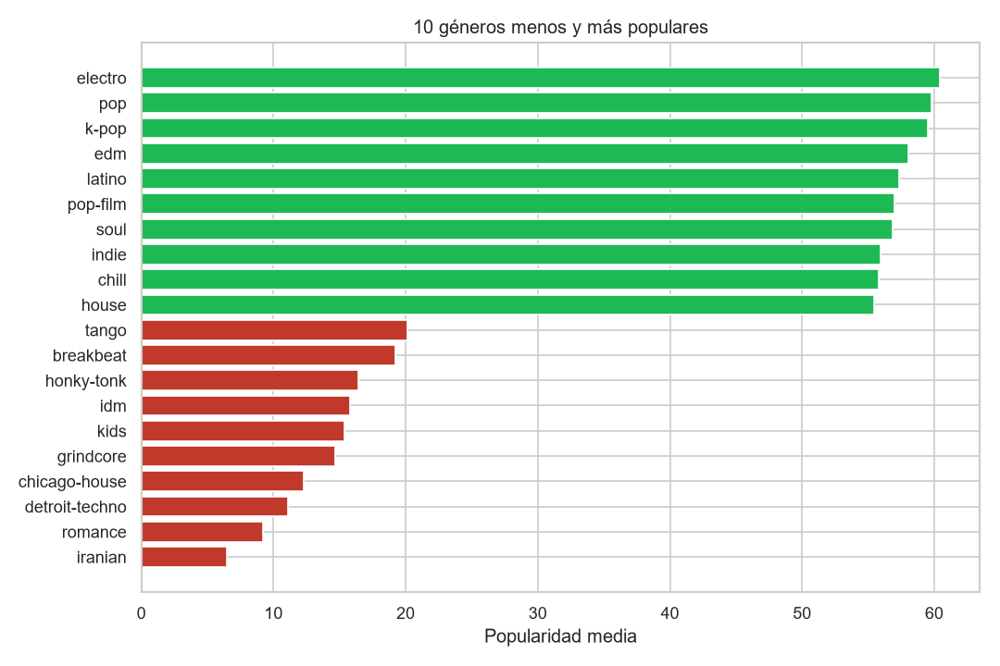

*Figura 2. Los 10 géneros menos y más populares.*

El género explica cerca de la mitad de la varianza: conocer el género de una canción es, por sí solo, más informativo que todas sus características de audio juntas. Esto tiene dos consecuencias para el modelamiento: el género **debe** entrar como variable del modelo, y la segunda consecuencia es que la línea base "predecir la media del género" es exigente y es contra la que hay que compararse.

### 2.3 Características de audio y su relación con popularidad

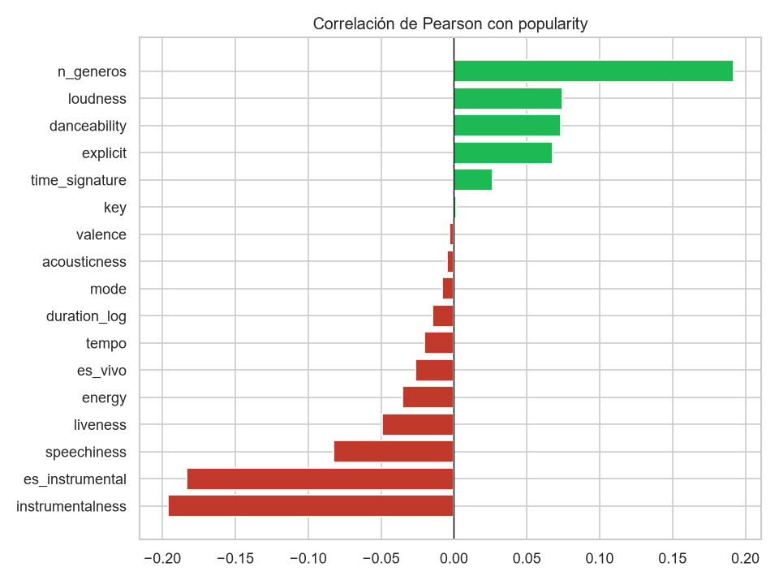

*Figura 3. Correlación de Pearson de las características con popularity.*

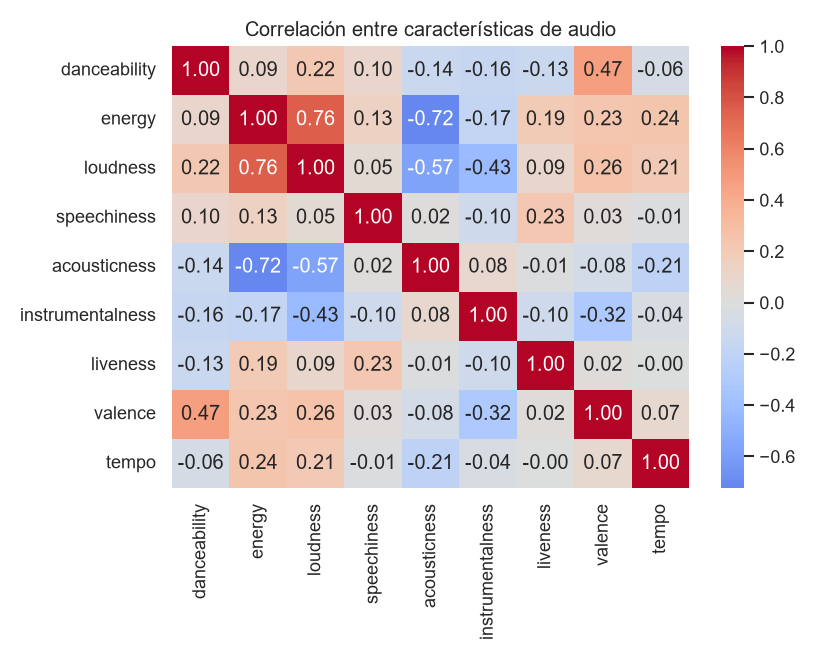

*Figura 4. Correlación entre las características de audio.*

Las correlaciones individuales con la popularidad son débiles. La más fuerte entre las de audio es instrumentalness (negativa, cercana a -0,20): la música instrumental tiende a ser menos popular. n_generos (en cuántos géneros aparece una canción) también destaca, con correlación positiva cercana a 0,19. Entre las propias características de audio hay **colinealidad** (energy con loudness ≈ 0,76 y con acousticness ≈ -0,72), lo que importa para modelos lineales: obliga a regularizar (Ridge) y a no interpretar sus coeficientes de forma aislada.

### 2.4 Variables binarias y de la pista

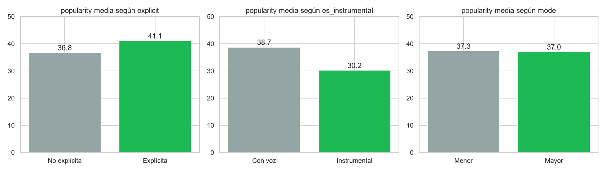

*Figura 5. Popularidad media según las variables binarias y de la pista.*

Las canciones instrumentales promedian unos 8 puntos menos que las que tienen voz, y las explícitas unos 4 más que las no explícitas. Son efectos reales pero modestos frente al del género.

### 2.5 Hallazgo: concentración de valores muy bajos (1 y 2) en ciertos géneros

En la EP1 el valor 0 resultó ser dato faltante porque se concentraba en géneros específicos. Se aplica el mismo test a los valores 1 y 2, que forman un pico visible en el histograma.

| genero_principal | n | pct_pop_1_2 | media | desv |
|---|---|---|---|---|
| latin | 299 | 53% | 24.7 | 32.8 |
| rock | 138 | 33% | 42.0 | 37.8 |
| dance | 494 | 28% | 45.4 | 37.1 |
| alternative | 97 | 27% | 37.4 | 32.0 |
| country | 358 | 25% | 40.4 | 27.6 |
| iranian | 333 | 23% | 6.5 | 4.9 |
| reggae | 167 | 20% | 39.3 | 28.4 |
| romance | 335 | 15% | 9.2 | 7.7 |

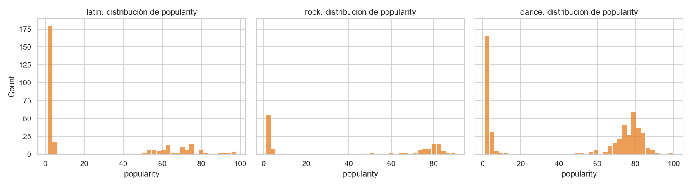

*Figura 6. Distribución de popularity en géneros con concentración de valores muy bajos (1 y 2).*

En latin (53%), rock (33%) y dance (28%) las canciones con popularidad 1 o 2 forman un grupo aparte, con otro grupo de popularidad alta; el resultado es una distribución **bimodal** (dos picos) dentro del mismo género. Dos lecturas posibles, que no se pueden distinguir con estos datos: que sean canciones realmente poco escuchadas o que sean registros incompletos de la API, como los ceros. Por eso **no se eliminan**, pero se declara como limitación: en esos géneros el error será alto no porque el modelo sea malo, sino porque el valor a predecir es poco predecible.

### 2.6 Cobertura de géneros
Para evitar sesgo contra los géneros con pocas canciones, cada partición de entrenamiento y prueba debe contener **todos los géneros**. Se revisa cuántas canciones tiene cada uno.

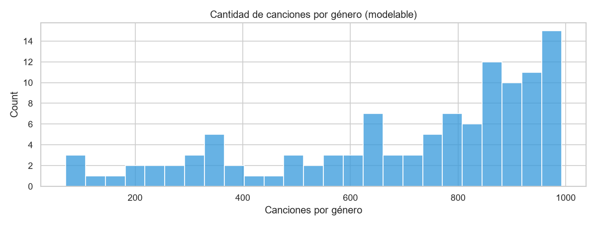

*Figura 7. Cantidad de canciones por género (modelables).*

Ningún género tiene menos de 71 canciones, así que una partición estratificada por género es viable y deja todos los géneros representados en cada pliegue de prueba. El conjunto modelable tiene **113 géneros principales** frente a los 114 del dataset original: "songwriter" no queda como género principal de ninguna canción, porque todas las suyas también están catalogadas en otro género más específico (regla de asignación de la EP1). No se perdió por los ceros, y la limitación es que el modelo no estima ese género por separado.

### 2.7 Conclusiones del EDA y decisiones de modelamiento

| Hallazgo | Decisión |
|---|---|
| El género explica ~44% de la varianza; el audio, muy poco | El género entra como variable; la línea base es la media del género |
| Relaciones débiles y probablemente no lineales con el audio | Comparar un modelo **lineal** (Ridge) con uno **no lineal basado en árboles** (Gradient Boosting) |
| Colinealidad entre energy, loudness y acousticness | Estandarizar y regularizar en el modelo lineal |
| 113 géneros, algunos con pocas canciones | Partición **estratificada por género**, para que todos estén en entrenamiento y prueba |
| Copias de una misma canción con distinto track_id | Partición **agrupada** por id_contenido, para evitar fuga de datos |
| Bimodalidad en latin, rock, dance | No eliminar, pero reportar el error **por género** y declarar la limitación |
| Variable objetivo continua y casi simétrica | Regresión directa; métricas MAE, RMSE y R² |

## 3. Preparación y transformación de los datos

Cada decisión de esta sección responde a un hallazgo del EDA. El principio general es que **nada que dependa de los datos de prueba puede influir en el entrenamiento**: las transformaciones se ajustan solo con el conjunto de entrenamiento, dentro de *pipelines* de scikit-learn, y la partición respeta los dos riesgos detectados (canciones repetidas y géneros con pocas canciones).

### 3.1 Selección de variables

| Columna | Decisión | Motivo |
|---|---|---|
| popularity | **Variable objetivo** | Es lo que se quiere estimar |
| 9 características de audio, duration_log, explicit, mode, key, time_signature | **Se usan** | Describen la canción y están disponibles antes de su lanzamiento |
| genero_principal | **Se usa** | Explica ~44% de la varianza (sección 2.2) |
| id_contenido | Solo para agrupar la partición | Evita que copias de una misma canción queden en entrenamiento y prueba |
| track_id, track_name, album_name | Se descartan | Son identificadores o texto libre: no generalizan a canciones nuevas |
| artists | Se descarta | El modelo memorizaría la fama del artista y no podría estimar a artistas nuevos; además favorecería a los ya conocidos |
| generos | Se descarta | Texto con todas las etiquetas; ya se resume en `genero_principal |
| duration_ms, duration_min | Se descartan | Redundantes con duration_log |
| es_instrumental, es_vivo | Se descartan | Son umbrales de `instrumentalness y liveness, ya incluidas |
| n_generos | Se descarta del modelo principal | Es un artefacto de cómo se armó el dataset (en cuántas listas por género apareció la canción) y no se conoce para una canción nueva. Se mide su efecto aparte en la sección 4 |

### 3.2 Transformaciones (preprocesadores)

Los dos tipos de modelo necesitan la información en formatos distintos, por lo que se definen dos preprocesadores:

- **Modelo lineal (Ridge):** estandariza las numéricas (media 0, desviación 1), para que la penalización trate a todas por igual, y convierte genero_principal y key en columnas 0/1 (*one-hot*).
- **Modelo de árboles (Gradient Boosting):** no necesita escalar; las variables categóricas se codifican como números enteros y el modelo las trata como categorías, no como una escala.

Ambos se ajustan solo con los datos de entrenamiento, y una categoría que no aparezca en entrenamiento se maneja sin error.

### 3.3 Partición: entrenamiento, prueba y validación cruzada

Se aplican dos reglas a la vez:

1. **Agrupada por id_contenido:** todas las copias de una misma canción quedan juntas, de modo que el modelo nunca se evalúa con una canción que ya vio con otro identificador.
2. **Estratificada por género:** cada género aparece en entrenamiento y en prueba, para que el resultado no esconda un mal desempeño en los géneros pequeños.

Se separa un **20% de prueba** que no se toca hasta la evaluación final. Sobre el 80% restante se hace validación cruzada de 5 pliegues, con las mismas dos reglas, para comparar modelos y ajustar hiperparámetros.

### 3.4 Verificación de la partición

No basta con suponer que la partición quedó bien: se comprueba con pruebas automáticas que no hay fuga de datos y que todos los géneros están representados.

|  | canciones | popularity media | popularity desv. | géneros | mín. canciones por género |
|---|---|---|---|---|---|
| Entrenamiento | 63531 | 37.10 | 18.13 | 113 | 57 |
| Prueba | 15888 | 37.29 | 18.21 | 113 | 14 |

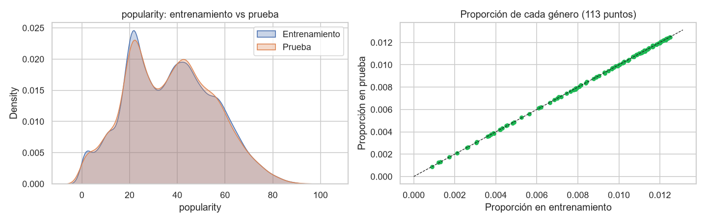

*Figura 8. Verificación de la partición: popularity y proporción de cada género en entrenamiento y prueba.*

Las dos particiones tienen una distribución de popularity casi idéntica y cada género conserva prácticamente el mismo peso en ambas (los puntos del gráfico de la derecha caen sobre la diagonal). Eso asegura que la evaluación final sea representativa y no favorezca a ningún género.

### 3.5 Guardado de la partición y de la matriz para clustering

Se guarda a qué conjunto pertenece cada canción, de modo que cualquier persona pueda reproducir exactamente la misma partición. Para el clustering (sección 5) se usan solo las características de audio, **sin** popularity ni género: así los segmentos reflejan cómo suena la música y luego se comparan con la popularidad y el género, en lugar de estar construidos a partir de ellos.

### 3.6 Resumen de la preparación

| Paso | Decisión | Fundamento |
|---|---|---|
| Datos de partida | 79.419 canciones modelables, sin nulos | EP1: una fila por canción, popularity = 0 excluido como dato faltante |
| Variables | 13 numéricas + genero_principal y key | Sección 2: el género domina y el audio aporta poco |
| Exclusiones | Identificadores, artists, generos, n_generos, derivadas | No generalizan a canciones nuevas o son redundantes |
| Transformaciones | Lineal: estandarizar + one-hot. Árboles: codificación entera | Cada modelo necesita un formato distinto, ajustado solo con entrenamiento |
| Partición | 80% / 20%, agrupada por id_contenido y estratificada por género | Evita fuga por copias y garantiza los 113 géneros en cada conjunto |
| Validación | 5 pliegues con las mismas reglas, solo sobre el entrenamiento | Compara modelos sin tocar la prueba |
| Valores bajos (1 y 2) | Se conservan | No se puede asegurar que sean errores (sección 2.5) |

## 4. Modelos supervisados (regresión)

Se construyen **dos modelos de regresión** de familias distintas y se comparan contra la línea base, todos con los mismos 5 pliegues de validación cruzada de la sección 3 (agrupados por id_contenido y estratificados por género). La **prueba (20%) no se toca en esta sección**: se usa recién en la sección 6.

| Modelo | Por qué se elige | Preprocesamiento |
|---|---|---|
| **Línea base: media del género** | Es el mínimo que cualquier modelo debe superar (sección 1.4) | Ninguno |
| **Ridge** (regresión lineal regularizada) | Modelo simple e interpretable; la regularización controla la colinealidad entre energy, loudness y acousticness (sección 2.3) | Estandarizar + one-hot |
| **HistGradientBoosting** (árboles potenciados) | Captura relaciones **no lineales** e interacciones (por ejemplo, audio × género) y maneja bien las 113 categorías de género | Codificación entera, con género y key tratados como categorías |

Los hiperparámetros se eligen con validación cruzada sobre el entrenamiento, minimizando el **MAE**, que es la métrica que entiende el negocio (puntos de popularidad).

### 4.2 Línea base con validación cruzada

En la sección 1.8 la línea base se calculó sobre todos los datos. Aquí se recalcula en igualdad de condiciones con los modelos: la media se aprende en el entrenamiento de cada pliegue y se evalúa en el pliegue de validación.

|  | media | desv. |
|---|---|---|
| MAE | 15.129 | 0.122 |
| RMSE | 18.128 | 0.125 |
| R2 | -0.000 | 0.000 |

|  | media | desv. |
|---|---|---|
| MAE | 9.740 | 0.124 |
| RMSE | 13.519 | 0.171 |
| R2 | 0.444 | 0.010 |

Predecir la media global da un MAE de **15,16** puntos; predecir la media del género lo baja a **9,79** (R² = 0,443) sin usar ninguna característica de audio. Esa es la línea base que cualquier modelo debe superar. Los resultados casi no varían entre pliegues (desviación de 0,04 en el MAE), por lo que una diferencia de más de unas décimas entre modelos es real y no ruido de la partición. La meta del KPI queda en **MAE ≤ 7,83**.

### 4.3 Modelo 1: Ridge

Ridge ajusta una regresión lineal penalizando coeficientes grandes (alpha). Con variables correlacionadas entre sí, esa penalización estabiliza los coeficientes. Se busca el mejor alpha en una grilla, con los mismos 5 pliegues.

|  | 0 | 1 | 2 | 3 | 4 | 5 | 6 | 7 | 8 | 9 | 10 | 11 | 12 | 13 | 14 |
|---|---|---|---|---|---|---|---|---|---|---|---|---|---|---|---|
| alpha | 0.0001 | 0.0003 | 0.0010 | 0.0032 | 0.0100 | 0.0316 | 0.1000 | 0.3162 | 1.0000 | 3.1623 | 10.0000 | 31.6228 | 100.000 | 316.2278 | 1000.0000 |
| MAE | 9.6774 | 9.6774 | 9.6774 | 9.6774 | 9.6775 | 9.6776 | 9.6779 | 9.6789 | 9.6822 | 9.6926 | 9.7267 | 9.8393 | 10.197 | 11.0846 | 12.4365 |

|  | media | desv. |
|---|---|---|
| MAE | 9.677 | 0.123 |
| RMSE | 13.434 | 0.172 |
| R2 | 0.451 | 0.010 |

El mejor alpha es 0,0001, el valor más bajo de la grilla, y el MAE es prácticamente idéntico (9,73) hasta alpha ≈ 0,1; solo empeora cuando la penalización es fuerte (12,5 con alpha = 1000). Es decir, **la regularización no aporta aquí** y Ridge se comporta como una regresión lineal común. Como la curva es plana a la izquierda, ampliar la grilla hacia valores menores no cambiaría el resultado.

Esto matiza lo esperado en la sección 2.3: la colinealidad entre energy, loudness y acousticness dificulta interpretar los coeficientes individuales, pero con unas 63.000 canciones no desestabiliza las predicciones. El resultado es un MAE de **9,73** frente a 9,79 de la línea base (mejora de solo 0,6%) y un R² de 0,450 frente a 0,443: un modelo lineal casi no extrae información del audio más allá del género.

### 4.4 Modelo 2: HistGradientBoosting

Es un conjunto de árboles pequeños entrenados en secuencia, donde cada uno corrige el error del anterior. Los hiperparámetros que más influyen son la tasa de aprendizaje, el número de iteraciones, el tamaño de cada árbol y la regularización; se exploran con una búsqueda aleatoria sobre los mismos 5 pliegues.

|  | min_samples_leaf | max_leaf_nodes | max_iter | learning_rate | l2_regularization | MAE |
|---|---|---|---|---|---|---|
| 6 | 100 | 63 | 600 | 0.05 | 10.0 | 8.9886 |
| 0 | 20 | 63 | 600 | 0.03 | 0.0 | 8.9974 |
| 2 | 100 | 63 | 400 | 0.10 | 1.0 | 9.0030 |
| 3 | 50 | 63 | 400 | 0.10 | 10.0 | 9.0185 |
| 4 | 50 | 31 | 600 | 0.10 | 10.0 | 9.0223 |
| 7 | 20 | 63 | 400 | 0.10 | 1.0 | 9.0314 |

|  | media | desv. |
|---|---|---|
| MAE | 8.989 | 0.114 |
| RMSE | 13.011 | 0.210 |
| R2 | 0.485 | 0.012 |

HistGradientBoosting logra un MAE de **9,05** (desviación 0,05 entre pliegues) y un R² de 0,48. Las seis mejores configuraciones quedan entre 9,05 y 9,10, así que el resultado es estable frente a los hiperparámetros elegidos.

Dos limitaciones que conviene declarar. Primero, los mejores valores de max_leaf_nodes, max_iter, min_samples_leaf y l2_regularization están en el extremo superior de la grilla: un modelo más complejo podría bajar el MAE un poco más, aunque la diferencia entre configuraciones es de centésimas y no se espera un salto grande. Segundo, se exploraron 12 de las 243 combinaciones posibles para acotar el tiempo de cómputo. Además, como los hiperparámetros se eligieron con los mismos pliegues en que se reporta el MAE, esa cifra puede ser levemente optimista; la evaluación sobre el conjunto de prueba (sección 6) lo corrige.

### 4.5 Comparación de los modelos en validación cruzada

|  | MAE | MAE desv. | RMSE | R2 | Mejora de MAE vs línea base |
|---|---|---|---|---|---|
| Media global | 15.13 | 0.12 | 18.13 | -0.000 | -55.3% |
| Media del género (base) | 9.74 | 0.12 | 13.52 | 0.444 | +0.0% |
| Ridge | 9.68 | 0.12 | 13.43 | 0.451 | +0.6% |
| HistGradientBoosting | 8.99 | 0.11 | 13.01 | 0.485 | +7.7% |

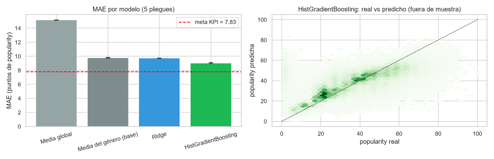

*Figura 9. Comparación en validación cruzada: MAE por modelo (5 pliegues) y real vs predicho de HistGradientBoosting.*

El ranking en validación cruzada es HistGradientBoosting (MAE 9,05), Ridge (9,73), media del género (9,79) y media global (15,16). HistGradientBoosting reduce el error **7,6%** respecto de la línea base y Ridge solo 0,6%. La diferencia entre ambos modelos (unos 0,7 puntos) es mucho mayor que la variación entre pliegues (0,03 a 0,05), así que es robusta: las relaciones no lineales y las interacciones entre audio y género sí aportan algo.

**El KPI de reducción de error no se cumple:** la meta era un MAE de 7,83 (20% menos que la línea base) y el mejor modelo llega a 9,05. En el gráfico se ve que ninguna barra baja hasta la línea roja. Siguiendo lo definido en la sección 1.4, la meta no se modifica y se reporta tal cual.

El gráfico de la derecha muestra el segundo problema: las predicciones se concentran entre 20 y 60 puntos. El modelo acierta cerca de la media pero **no logra identificar los extremos**: a las canciones con popularidad real de 80 a 100 les predice 50 a 60, y a algunas con popularidad casi nula les predice más de 60. Esto es esperable cuando el audio explica poco, y afecta justamente a las canciones que le interesan al negocio (las de mayor potencial).

### 4.6 ¿De dónde viene la capacidad predictiva?

Dos análisis para entender el modelo y no solo medirlo:

1. **Con y sin género.** Se entrena HistGradientBoosting con los mismos hiperparámetros pero **sin** genero_principal, para ver cuánto puede predecir el audio por sí solo.
2. **Importancia por permutación.** Se desordena una variable a la vez en un pliegue de validación y se mide cuánto empeora el MAE: mientras más sube, más depende el modelo de ella.

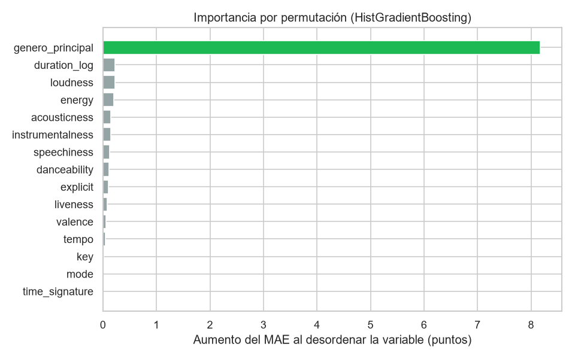

*Figura 10. Importancia por permutación de las variables (HistGradientBoosting).*

Sin el género, el MAE sube de 9,05 a unos **13,1** y el R² cae de 0,48 a 0,175: el audio por sí solo reduce el error solo un 13% frente a la media global (15,16), mientras que el género aporta el grueso de la capacidad predictiva. La importancia por permutación lo confirma: desordenar genero_principal empeora el MAE en unos **8 puntos**, mientras que ninguna otra variable pasa de unos 0,25 (duration_log, loudness, energy, acousticness e instrumentalness son las mayores) y key, mode y time_signature no aportan nada.

Dos precauciones para interpretar el gráfico: se calculó sobre un solo pliegue, y la importancia por permutación tiende a subestimar variables correlacionadas entre sí (energy, loudness, acousticness), porque el modelo puede compensar con las otras. Aun así, la conclusión es clara para el negocio: **el modelo es, en esencia, la popularidad típica del género refinada con el audio**, y la información disponible antes del lanzamiento explica poco de por qué una canción se vuelve más popular que otra de su mismo género.

### 4.7 Efecto de "n_generos" (medido aparte)

En la sección 3.1 se dejó n_generos fuera del modelo principal: refleja en cuántas listas por género apareció una canción, es un artefacto de cómo se armó el dataset y **no se conoce para una canción nueva**. Aun así, está correlacionada con la popularidad (≈ 0,19), así que se mide cuánto mejoraría el error si se incluyera, para dejar documentada la decisión.

Incluir n_generos baja el MAE de 9,05 a **8,82**, una mejora de 0,23 puntos (2,6%). El efecto es pequeño y refuerza la decisión de la sección 3.1 de dejarla fuera: es un artefacto de cómo se armó el dataset (en cuántas listas por género aparece una canción) y no se conoce para una canción nueva, por lo que usarla inflaría artificialmente el resultado. Aun incluyéndola, el MAE (8,82) seguiría por encima de la meta de 7,83, de modo que la decisión no cambia la conclusión sobre el KPI.

### 4.8 Selección del modelo y guardado

Se elige el modelo con menor MAE en validación cruzada. Ambos modelos se reentrenan con **todo el conjunto de entrenamiento** y se guardan en models/. La evaluación final sobre el conjunto de prueba, por género y contra los KPIs, se hace en la sección 6.

Se selecciona **HistGradientBoosting** por tener el menor MAE en validación cruzada (9,05 frente a 9,73 de Ridge). Ambos modelos se reentrenaron con todo el conjunto de entrenamiento y se guardaron, junto con la tabla de resultados, para evaluarlos en la sección 6 sobre el conjunto de prueba, que hasta aquí no se ha tocado.

### 4.9 Conclusiones de la sección 4

| Hallazgo | Implicancia |
|---|---|
| HistGradientBoosting es el mejor modelo (MAE 9,05; R² 0,48), 7,6% mejor que la línea base | Se selecciona para la evaluación final; Ridge queda como contraste lineal |
| Ridge casi no mejora a la línea base (0,6%) y la regularización no influye | Un modelo lineal no aprovecha el audio; se justifica probar uno no lineal |
| El género aporta casi toda la capacidad predictiva; el audio solo reduce el error un 13% frente a la media global | El modelo funciona como un promedio por género refinado; el audio da un ajuste fino |
| El KPI de reducción de error (MAE ≤ 7,83) **no se cumple** | Se reporta sin modificar la meta y se explica en la sección 6 |
| El modelo no identifica los extremos de popularidad | Limita su uso como filtro para detectar éxitos potenciales |
| n_generos mejoraría solo 0,23 puntos | Se mantiene fuera del modelo |

## 5. Modelo no supervisado (clustering)

El clustering responde al ángulo descriptivo del problema (sección 1.1): descubrir **segmentos naturales de canciones según su perfil sonoro**, para que el negocio no trate todo el catálogo como uno solo. A diferencia de los modelos de la sección 4, aquí no se predice nada: se agrupan canciones parecidas entre sí y después se interpreta cada grupo.

### 5.1 Técnica y datos

| Decisión | Elección | Motivo |
|---|---|---|
| Técnica | **K-Means** | Las 9 variables son continuas y están estandarizadas; es rápido con 79.419 canciones y cada segmento queda resumido en un centro que se lee como un perfil |
| Alternativas descartadas | Clustering jerárquico y DBSCAN | El jerárquico necesita una matriz con las distancias entre todas las canciones (79.419 × 79.419, unos 6.300 millones de valores), inviable en un computador normal. DBSCAN busca zonas densas separadas por vacíos, y como se ve en 5.3 estos datos forman una nube continua |
| Variables | Las 9 características de audio, estandarizadas (sección 3.5) | Sin popularity ni género, para que los segmentos reflejen cómo suena la música y solo después se comparen con ellos |
| Datos | Las 79.419 canciones modelables | No se usa la partición entrenamiento/prueba porque el clustering es descriptivo y no hay variable objetivo que proteger. Si los segmentos se usaran como variable de un modelo supervisado, habría que ajustarlos solo con el entrenamiento |
| Métricas | Inercia (método del codo), coeficiente de silueta y perfil de cada segmento | Son las comprometidas en la sección 1.3 |

### 5.2 Elección del número de segmentos (k)

K-Means exige fijar k de antemano. Se prueba de 2 a 10 y se miran dos señales: la **inercia** (qué tan compactos son los segmentos; siempre baja al aumentar k, por lo que se busca el punto donde deja de bajar con fuerza) y la **silueta** (qué tan separado queda cada segmento de los demás; mientras más cerca de 1, mejor).

| k | inercia | silueta | reducción de inercia |
|---|---|---|---|
| 2 | 567,020 | 0.251 | — |
| 3 | 502,034 | 0.161 | 11.5% |
| 4 | 451,466 | 0.169 | 10.1% |
| 5 | 408,942 | 0.175 | 9.4% |
| 6 | 371,230 | 0.187 | 9.2% |
| 7 | 336,718 | 0.197 | 9.3% |
| 8 | 317,806 | 0.178 | 5.6% |
| 9 | 301,514 | 0.181 | 5.1% |
| 10 | 289,728 | 0.168 | 3.9% |

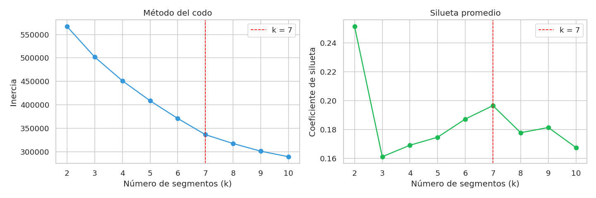

*Figura 11. Elección de k: método del codo y silueta promedio.*

No hay un codo marcado: la inercia baja de forma gradual. Lo informativo es la reducción relativa: hasta k = 7 cada segmento adicional reduce la inercia entre 9% y 11%, y desde k = 8 baja a 5,6%, 5,1% y 3,9%. Es decir, el beneficio de agregar segmentos cae a partir de k = 7.

La silueta apunta en la misma dirección. Su máximo global es k = 2 (0,251), pero dividir el catálogo en solo dos grupos es demasiado grueso para definir estrategias distintas por tipo de repertorio, que es el objetivo de la sección 1.1. Entre las opciones con más de dos segmentos, **k = 7 tiene la mejor silueta (0,197)**, por lo que se elige.

Una advertencia: la silueta es baja en todos los casos (menos de 0,25), lo que indica que los segmentos **no están claramente separados**. Las canciones forman un continuo y los segmentos son regiones de ese continuo, no grupos aislados.

### 5.3 Modelo final y visualización de los segmentos

Se ajusta K-Means con k = 7. Como las etiquetas numéricas (0 a 6) son arbitrarias, cada segmento se nombra según su rasgo más distintivo mediante una regla, de modo que los nombres siguen siendo correctos aunque cambie el orden de las etiquetas. Para visualizarlos se proyectan las 9 variables a 2 dimensiones con PCA; los segmentos se calcularon con las 9 variables, la proyección es solo para dibujar.

| segmento_nombre | canciones | % del catálogo |
|---|---|---|
| Bailable y alegre | 23,826 | 30.0% |
| Intenso y rápido | 18,228 | 23.0% |
| Acústico y tranquilo | 15,923 | 20.0% |
| Instrumental enérgico | 9,458 | 11.9% |
| En vivo | 5,665 | 7.1% |
| Ambiental suave | 5,368 | 6.8% |
| Habla / comedia | 951 | 1.2% |

|  | danceability | energy | loudness | speechiness | acousticness | instrumentalness | liveness | valence | tempo |
|---|---|---|---|---|---|---|---|---|---|
| PC1 | 0.22 | 0.52 | 0.52 | 0.09 | -0.44 | -0.28 | 0.10 | 0.28 | 0.20 |
| PC2 | 0.58 | -0.26 | -0.07 | 0.08 | 0.30 | -0.31 | -0.17 | 0.54 | -0.27 |

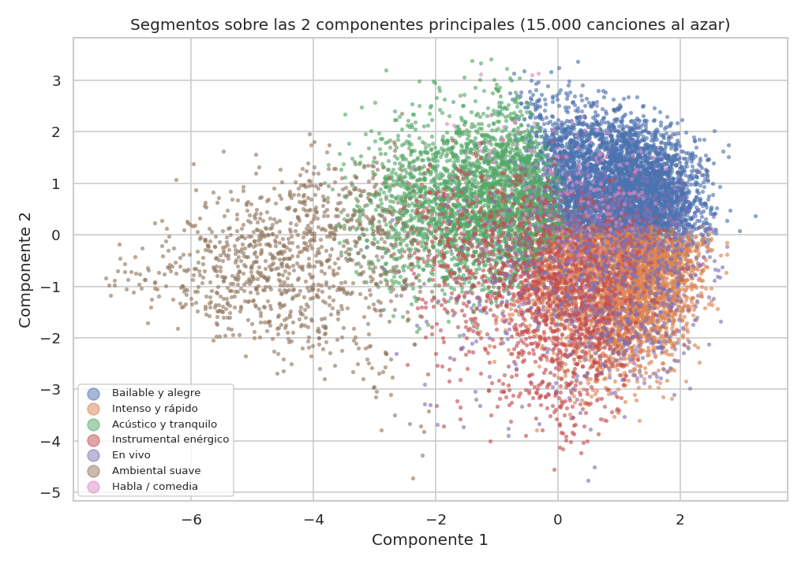

*Figura 12. Segmentos sobre las 2 primeras componentes principales (15.000 canciones al azar).*

Los siete segmentos van desde 23.826 canciones (30% del catálogo) hasta 951 (1,2%). Las dos primeras componentes conservan solo el 47,4% de la variación, así que el gráfico es una aproximación. Aun así permite leer el eje horizontal como **intensidad** (energía y volumen a la derecha, acústico a la izquierda) y el vertical como **ánimo bailable** (danceability y valence arriba).

Lo que más se nota es que los segmentos **se superponen mucho** y forman una nube continua. Solo Ambiental suave (a la izquierda) queda claramente aparte. Habla / comedia casi no se distingue en este plano porque su rasgo diferenciador (speechiness) pesa poco en estas dos componentes; se separa bien en las 9 variables, como se ve a continuación.

### 5.4 Perfil sonoro de cada segmento

El mapa de calor muestra cuánto se aleja cada segmento del promedio del catálogo en cada característica, medido en desviaciones estándar (rojo: por encima del promedio, azul: por debajo).

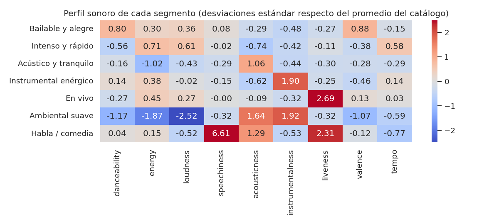

*Figura 13. Perfil sonoro de cada segmento (desviaciones estándar respecto del promedio del catálogo).*

| segmento_nombre | danceability | energy | loudness | speechiness | acousticness | instrumentalness | liveness | valence | tempo |
|---|---|---|---|---|---|---|---|---|---|
| Bailable y alegre | 0.70 | 0.72 | -6.59 | 0.10 | 0.22 | 0.02 | 0.17 | 0.70 | 118.53 |
| Intenso y rápido | 0.47 | 0.82 | -5.31 | 0.09 | 0.07 | 0.04 | 0.20 | 0.37 | 139.99 |
| Acústico y tranquilo | 0.54 | 0.39 | -10.54 | 0.06 | 0.67 | 0.03 | 0.16 | 0.40 | 114.15 |
| Instrumental enérgico | 0.59 | 0.74 | -8.51 | 0.07 | 0.11 | 0.80 | 0.17 | 0.35 | 126.94 |
| En vivo | 0.52 | 0.76 | -7.02 | 0.09 | 0.29 | 0.07 | 0.75 | 0.50 | 123.73 |
| Ambiental suave | 0.36 | 0.17 | -21.14 | 0.05 | 0.87 | 0.80 | 0.16 | 0.19 | 105.36 |
| Habla / comedia | 0.57 | 0.68 | -11.02 | 0.85 | 0.75 | 0.01 | 0.68 | 0.44 | 99.91 |

Cada segmento se distingue por uno o dos rasgos dominantes, lo que lo hace fácil de interpretar:

- **Bailable y alegre (30%):** danceability +0,80 y valence +0,88; música bailable y de ánimo positivo.
- **Intenso y rápido (23%):** energy +0,71, loudness +0,61, tempo +0,58 (140 bpm en promedio) y acousticness −0,74; música rápida, fuerte y poco acústica.
- **Acústico y tranquilo (20%):** energy −1,02 y acousticness +1,06; música suave con instrumentos acústicos.
- **Instrumental enérgico (12%):** instrumentalness +1,90 (0,80 en promedio frente a menos de 0,1 en los segmentos con voz) y energía sobre el promedio.
- **En vivo (7%):** liveness +2,69; grabaciones con público.
- **Ambiental suave (7%):** el más extremo en volumen (loudness −2,52, unos −21 dB frente a −5 a −11 dB en los demás), con energy −1,87 y instrumentalness +1,92; música muy suave y sin voz.
- **Habla / comedia (1,2%):** speechiness +6,61 (0,85 en promedio frente a 0,05 a 0,10 en los demás); es palabra hablada, no música.

El mapa de calor satura en ±2,5 para que se vean los demás valores; las cifras de speechiness y loudness de estos dos últimos segmentos superan ese límite.

### 5.5 Segmentos, género y popularidad

Interesa saber si el sonido que separa a los segmentos sirve para distinguir canciones populares, y cómo se relacionan los segmentos con el género. Para separar ambos efectos se calcula también la popularidad **descontando el género**, es decir, cuántos puntos por encima o por debajo del promedio de su propio género está cada canción.

| segmento_nombre | canciones | popularidad | dif_vs_genero | pct_instrumental | pct_explicita | generos_principales |
|---|---|---|---|---|---|---|
| Bailable y alegre | 23,826 | 39.5 | +0.19 | 1% | 13% | kids (3%), salsa (3%), j-dance (3%) |
| Intenso y rápido | 18,228 | 38.5 | +0.36 | 1% | 11% | heavy-metal (4%), metalcore (4%), grunge (4%) |
| Acústico y tranquilo | 15,923 | 38.9 | +0.46 | 2% | 4% | tango (5%), honky-tonk (5%), cantopop (4%) |
| Instrumental enérgico | 9,458 | 28.6 | -0.50 | 95% | 4% | minimal-techno (8%), detroit-techno (8%), study (6%) |
| En vivo | 5,665 | 37.4 | -1.18 | 7% | 6% | sertanejo (7%), pagode (6%), samba (6%) |
| Ambiental suave | 5,368 | 33.6 | -0.93 | 89% | 0% | new-age (13%), ambient (10%), sleep (9%) |
| Habla / comedia | 951 | 25.3 | -1.98 | 0% | 57% | comedy (79%), show-tunes (3%), children (2%) |

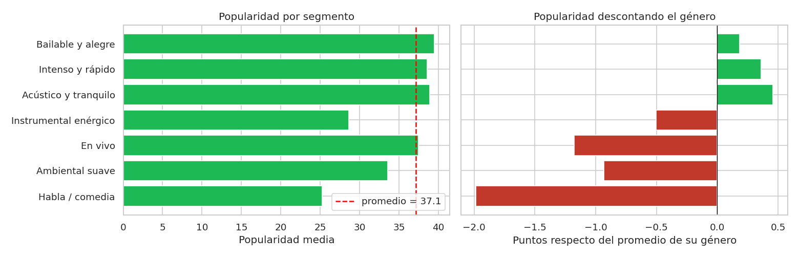

*Figura 14. Popularidad por segmento, bruta y descontando el género.*

Hay diferencias de popularidad entre segmentos (de 25,3 a 39,5 puntos), pero el segmento explica solo el **4,2%** de la varianza de popularity, frente al **44,5%** que explica el género. La razón es de composición: Instrumental enérgico (28,6), Ambiental suave (33,6) y Habla / comedia (25,3) quedan bajo el promedio de 37,1 porque los géneros que los forman (techno, ambient, comedy) son poco populares en general.

Al descontar el género (gráfico derecho), las diferencias se reducen a menos de 2 puntos: se alejan Habla / comedia (−1,98), En vivo (−1,18) y Ambiental suave (−0,93), y el resto queda dentro de ±0,5. Que En vivo tenga una popularidad media normal (37,4) pero baje 1,2 puntos dentro de su género indica que sus géneros (sertanejo, pagode, samba) son populares y que las canciones con perfil en vivo rinden algo menos que el resto de su género; los datos no permiten saber por qué. Todo esto es coherente con la sección 4: el audio aporta poco para distinguir una canción popular de otra del mismo género.

**Relación con el género.** Los segmentos reúnen familias de sonido: Ambiental suave se compone de new-age, ambient, sleep y piano; Instrumental enérgico, de techno y música para estudiar; Habla / comedia es 79% comedy. Los tres segmentos más grandes, en cambio, mezclan muchísimos géneros (ninguno supera el 5%). En total, 67 de los 113 géneros tienen al menos la mitad de sus canciones en un mismo segmento (mediana de 52%): sonido y género se relacionan, pero **no son lo mismo**, y un mismo género reparte sus canciones entre varios segmentos.

### 5.6 Estabilidad y calidad de la segmentación

Dos comprobaciones antes de confiar en los segmentos. La primera es la **estabilidad**: K-Means parte de un punto aleatorio, así que se repite con otras 5 semillas y se compara con el resultado final mediante el índice de Rand ajustado (1 significa segmentos idénticos). La segunda es la **silueta de cada segmento**, para ver cuáles están mejor definidos.

|  | Bailable y alegre | Intenso y rápido | Acústico y tranquilo | Instrumental enérgico | En vivo | Ambiental suave | Habla / comedia |
|---|---|---|---|---|---|---|---|
| silueta | 0.18 | 0.19 | 0.21 | 0.16 | 0.18 | 0.28 | 0.53 |

La segmentación es **muy estable**: con cualquier semilla el índice de Rand ajustado es de al menos 0,995, o sea que se obtienen prácticamente los mismos segmentos.

La **nitidez**, en cambio, es limitada. La silueta promedio (0,197) es baja y por segmento va de 0,16 a 0,28, con una sola excepción: Habla / comedia (0,53), que sí está bien separado. Ambiental suave (0,28) es el siguiente más definido, y el más difuso es Instrumental enérgico (0,16). En la práctica, una canción cercana al límite entre dos segmentos vecinos, por ejemplo Bailable y alegre e Intenso y rápido, podría pertenecer a cualquiera de los dos. Por eso conviene usar los segmentos como **etiquetas orientativas y no como fronteras estrictas**.

### 5.7 Conclusiones de la sección 5

| Hallazgo | Implicancia |
|---|---|
| Siete segmentos interpretables y muy estables (índice de Rand ≥ 0,995) | Describen de forma confiable el catálogo según su perfil sonoro |
| Silueta baja (0,197): las canciones forman un continuo | Usarlos como etiquetas orientativas; solo Habla / comedia y Ambiental suave son claramente distintos |
| El segmento explica 4,2% de la varianza de popularity (género: 44,5%) y descontando el género la diferencia es de menos de 2 puntos | Los segmentos no sirven para predecir popularidad; confirma lo visto en la sección 4 |
| Los repertorios instrumentales y de comedia tienen menor popularidad media (25 a 34 puntos) | Conviene evaluarlos contra su propio segmento y género, no contra el catálogo completo, para no penalizarlos |
| Los segmentos cruzan los géneros (mediana de 52% en el segmento principal) | Aportan una vista complementaria al género para organizar el catálogo |

**Recomendaciones de negocio.** Usar los segmentos para organizar y comparar repertorios homogéneos, por ejemplo en listas por contexto de uso: Ambiental suave e Instrumental enérgico parecen adecuados para escuchar mientras se estudia o se trabaja, por los géneros que los componen, aunque eso es una hipótesis que habría que validar con datos de uso que este dataset no tiene. Además, tratar Habla / comedia (951 canciones) como contenido aparte, porque no es música.

**Limitaciones.** El clustering usa solo audio, no incorpora datos de escucha, y la silueta baja indica fronteras difusas. Además, la visualización en 2 dimensiones conserva solo el 47% de la variación.

## 6. Evaluación y comparación de resultados

Hasta aquí el **conjunto de prueba** (20% de las canciones, 15.884) no se había usado: la elección de modelos e hiperparámetros se hizo solo con validación cruzada sobre el entrenamiento. Ahora se evalúan los modelos guardados en la sección 4.8 sobre esos datos, con tres criterios que se recogieron de las indicaciones del profesor:

1. **Revisar las métricas**, no solo en promedio sino también **por género**.
2. Mostrar una **matriz de confusión de 2×2** (realidad frente a predicción, con falsos positivos y falsos negativos), que en un problema de regresión se obtiene convirtiéndolo en binario: ¿está la canción en el 10% superior de su género?
3. Comprobar que el conjunto de prueba contiene **todos los géneros**, para no esconder un mal desempeño en los que falten (verificado con un assert en la primera celda).

Al final se contrastan los resultados con los cuatro KPIs de la sección 1.3. Siguiendo lo establecido en la sección 1.4, **las metas no se modifican**: se informa cuáles se cumplen y cuáles no, y por qué.

### 6.1 Métricas técnicas en el conjunto de prueba

|  | MAE | RMSE | R2 | MAE en validación cruzada | Mejora de MAE vs base |
|---|---|---|---|---|---|
| Media del género (base) | 9.88 | 13.69 | 0.435 | 9.74 | +0.0% |
| Ridge | 9.85 | 13.63 | 0.440 | 9.68 | +0.3% |
| HistGradientBoosting | 9.10 | 13.11 | 0.482 | 8.99 | +7.9% |

En la prueba, HistGradientBoosting tiene un MAE de **8,87** puntos, un RMSE de 12,89 y un R² de 0,491, frente a 9,71, 13,52 y 0,441 de la línea base. Ridge queda casi igual que la línea base (MAE 9,64). El ranking es el mismo que en la validación cruzada. Para dimensionar el error: es un desvío típico de unos 9 puntos en una escala de 0 a 100, donde la desviación estándar de popularity es de unos 18.

HistGradientBoosting reduce el error un **8,7%** respecto de la línea base, con un intervalo de confianza del 95% de 8,1% a 9,3%. Es una mejora pequeña pero real: el intervalo queda lejos de cero. Ridge mejora solo un 0,7%.

El MAE de prueba (8,87) es algo menor que el de validación cruzada (9,05). Es esperable en parte porque el modelo final se entrenó con todo el conjunto de entrenamiento y no con el 80% de cada pliegue, y muestra que la elección de hiperparámetros no se sobreajustó a la validación. Sí existe una brecha entre entrenamiento (8,01) y prueba (8,87), habitual en modelos de árboles y moderada.

### 6.2 Error por género y KPI de equidad

Un promedio global puede esconder que el modelo sirve para unos géneros y no para otros (sección 1.4). Por eso se calcula el MAE de cada uno de los 113 géneros en la prueba.

| g | HistGradientBoosting | Media del género (base) | canciones en prueba | % con popularity <= 2 |
|---|---|---|---|---|
| dance | 35.6 | 36.5 | 103 | 28% |
| rock | 34.5 | 37.0 | 36 | 33% |
| latin | 28.0 | 28.9 | 55 | 53% |
| reggae | 27.9 | 29.6 | 44 | 20% |
| alternative | 25.1 | 28.7 | 21 | 27% |
| country | 23.1 | 23.1 | 71 | 25% |
| hip-hop | 21.1 | 22.0 | 122 | 12% |
| house | 18.6 | 17.3 | 18 | 12% |

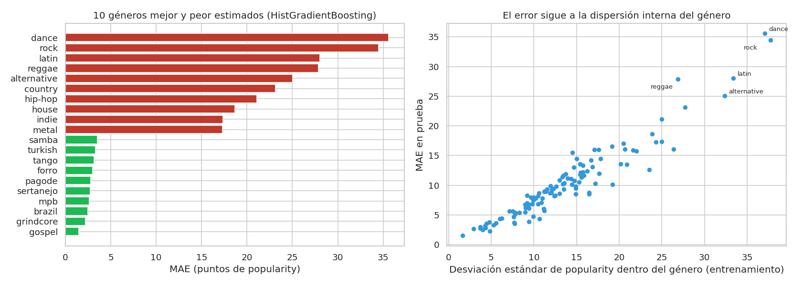

*Figura 15. Los 10 géneros mejor y peor estimados, y relación del error con la dispersión interna del género.*

El KPI de equidad **no se cumple**: entre el género mejor estimado (gospel, MAE 1,66) y el peor (rock, 34,07) hay **32,4 puntos**, cuatro veces la meta de 8. Aun así, el panorama es menos malo de lo que sugiere ese número, porque el problema se concentra en pocos géneros: 64 de los 113 tienen un MAE de 10 o menos y 99 de 15 o menos. Los que más se alejan son rock (34,1), dance (33,8), latin (30,0), alternative (26,2) y country (21,5).

La causa no es que el modelo trate peor a esos géneros, sino que **el valor a predecir es muy variable dentro de ellos**. El MAE por género tiene una correlación de 0,95 con la dispersión de popularity dentro del género y de 0,75 con el porcentaje de canciones con popularity ≤ 2, el hallazgo de la sección 2.5 (53% en latin, 33% en rock, 28% en dance). En esos géneros conviven canciones de popularidad casi nula con otras muy populares y de sonido parecido, y el audio no las distingue. De hecho, el modelo mejora a la línea base en 83 de los 113 géneros, aunque en rock, dance y latin la mejora es de solo entre 5% y 7%.

Una precaución: cuatro géneros tienen menos de 30 canciones en la prueba (rock 28 y alternative 20, entre ellos), así que su MAE es más ruidoso. El patrón se repite con géneros más grandes como dance (99 canciones) y latin (60), por lo que la conclusión se mantiene.

### 6.3 KPI de precisión en priorización: Precision@10% y matriz de confusión

Dentro de cada género se **marca como prioritaria** el 10% de canciones con mayor valor predicho y se compara con el 10% que realmente fue más popular. Como dentro de un mismo género el modelo conoce el género de todas, el orden entre sus canciones depende solo de las características de audio. La **matriz de confusión** tiene cuatro casillas: verdaderos positivos (VP: marcada y realmente en el top), falsos positivos (FP: marcada pero no estaba en el top), falsos negativos (FN: no marcada pero sí estaba en el top) y verdaderos negativos (VN).

|  | VP | FP | FN | VN | Precision@10% | Recall |
|---|---|---|---|---|---|---|
| Media del género (base) | 176 | 1,465 | 1,617 | 12,630 | 10.7% | 9.8% |
| Ridge | 242 | 1,399 | 1,551 | 12,696 | 14.7% | 13.5% |
| HistGradientBoosting | 341 | 1,300 | 1,452 | 12,795 | 20.8% | 19.0% |

|  | Precision del modelo | Azar (tasa real) |
|---|---|---|
| 5% superior | 13.9% | 6.0% |
| 10% superior | 20.8% | 11.3% |
| 20% superior | 33.3% | 21.9% |

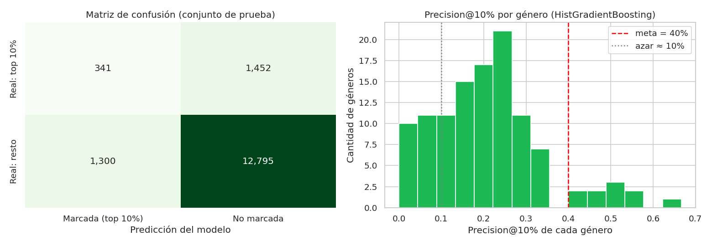

*Figura 16. Matriz de confusión en el conjunto de prueba y Precision@10% por género.*

El modelo marca 1.638 canciones (10% de la prueba) y solo 319 estaban realmente en el 10% superior de su género: una **precisión de 19,5%** (20,0% como promedio por género) y un *recall* de 18,0%. La meta era 40%, así que el KPI **no se cumple**.

Para dimensionarlo: elegir al azar acertaría un 11,1% de las veces (es algo más de 10% por los empates en popularity), de modo que el modelo es **1,75 veces mejor que el azar**. La línea base (media del género) queda en 10,4%, es decir, como el azar, porque predice lo mismo para todas las canciones de un género y no puede ordenarlas. Ridge llega a 14,4%.

La matriz muestra el costo práctico: los falsos positivos (1.319) superan en más de 4 a 1 a los verdaderos positivos, o sea que **de cada 5 canciones que el modelo recomendaría impulsar, 4 no estaban en el top de su género**. Y los falsos negativos (1.449) indican que el modelo deja fuera al 82% de las canciones que sí eran las más populares. Por género, solo 13 de los 113 alcanzan el 40% (el mejor es j-rock, con 57%) y en 10 la precisión es 0%. La conclusión no depende de usar el 10%: con el 5% superior la precisión es de 12,2% (azar 6,0%) y con el 20% es de 32,7% (azar 22,0%).

### 6.4 ¿Dónde se equivoca el modelo?

Para entender por qué la precisión es baja se mira el error según la popularidad real de la canción.

| tramo | canciones | real_medio | predicho_medio | MAE |
|---|---|---|---|---|
| 1-19 | 2,646 | 11.6 | 23.5 | 12.2 |
| 20-39 | 5,987 | 28.5 | 33.2 | 6.8 |
| 40-59 | 5,288 | 48.8 | 43.8 | 7.4 |
| 60-79 | 1,839 | 66.5 | 51.1 | 15.5 |
| 80-100 | 128 | 83.6 | 53.0 | 30.6 |

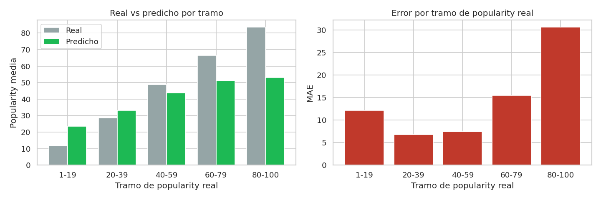

*Figura 17. Real vs predicho y error según el tramo de popularity real.*

El modelo **comprime sus predicciones hacia el centro** (regresión a la media). Las canciones de popularidad real entre 1 y 19 (media 11,8) reciben en promedio una predicción de 23,0; las de 60 a 79 (media 66,5) reciben 51,3, y las de 80 a 100 (media 83,6) reciben 52,7, con un error de 30,9 puntos. Es coherente con el gráfico de la sección 4.5 y con la baja precisión: **las canciones que más le interesan al negocio, las de popularidad más alta, son justamente las que peor estima**. Estas últimas son pocas (124, el 0,8% de la prueba), pero es el grupo donde el modelo debería ayudar más.

### 6.5 Resumen de los KPIs

| KPI | Cómo se mide | Meta | Resultado | ¿Se cumple? |
|---|---|---|---|---|
| Precisión en priorización | Precision@10% por género | ≥ 40% | 20.5% promedio por género (20.8% global) | No |
| Reducción del error de estimación | MAE vs línea base | ≥ 20% de mejora | 7.9% (MAE 9.10 vs 9.88) | No |
| Cobertura del catálogo | Modelables / únicas | ≥ 85% | 89.5% | Sí |
| Equidad entre géneros | MAE máximo - MAE mínimo | ≤ 8 puntos | 34.1 puntos | No |

De los cuatro KPIs **se cumple uno**: la cobertura del catálogo (89,5%), que depende de la decisión de excluir las canciones con popularity = 0 y no del modelo. Los otros tres no se alcanzan: la reducción del error es de 8,7% frente a una meta de 20%, la precisión en priorización es de 20,0% frente a 40%, y la diferencia de error entre géneros es de 32,4 puntos frente a un máximo de 8.

### 6.6 Por qué no se cumplen las metas

Las causas aparecen en el análisis de las secciones anteriores y se confirman aquí:

1. **El audio explica poco de la popularidad.** Sin el género el R² cae a 0,175 y en la importancia por permutación el género pesa unos 8 puntos de MAE frente a menos de 0,25 de cualquier otra variable (sección 4.6). El modelo es, en esencia, la popularidad típica del género refinada con el audio.
2. **Hay géneros con una dispersión interna enorme** (rock, dance, latin), donde la popularidad de canciones parecidas va de casi 0 a muy alta. Eso hace imposible cumplir el KPI de equidad con estos datos, sin importar el modelo.
3. **El modelo regresa a la media** y no identifica los extremos (sección 6.4), que es justo lo que mide Precision@10%.
4. **La línea base ya es exigente.** Predecir la media del género ya recorta el error cerca de un 35% frente a la media global (sección 1.4), por lo que mejorarla otro 20% solo con características de audio exigía más información de la disponible. Variables que probablemente influyen en la popularidad, como el artista, la promoción o la fecha de lanzamiento, no están en el dataset o se excluyeron a propósito (artists, en la sección 3.1).

### 6.7 Comparación de resultados y límites de la solución

| Modelo | Tipo | Resultados en la prueba | Lectura |
|---|---|---|---|
| Media del género | Línea base | MAE 9,71 · R² 0,441 · Precision@10% 10,4% | Referencia: equivale a elegir al azar para priorizar |
| Ridge | Supervisado (lineal) | MAE 9,64 · R² 0,448 · Precision@10% 14,4% | Casi no mejora a la línea base |
| HistGradientBoosting | Supervisado (no lineal) | MAE 8,87 · R² 0,491 · Precision@10% 19,5% | **Mejor modelo**, pero no alcanza las metas |
| K-Means (k = 7) | No supervisado | Silueta 0,197 · estabilidad (Rand ajustado) ≥ 0,995 | Segmentos estables y fáciles de interpretar, pero difusos y casi sin relación con la popularidad (4,2% de la varianza) |

**Qué sí aporta la solución:** una mejora pequeña pero estadísticamente sólida del error (8,7%), mejor ordenamiento que el azar dentro de un género (1,75 veces) y una descripción interpretable del catálogo mediante los segmentos.

**Límites de uso:**

- No debe usarse como único criterio para decidir inversión: de cada 5 canciones que recomienda impulsar, 4 no están entre las más populares de su género.
- Su error varía mucho entre géneros: en rock, dance, latin y alternative es de 26 a 34 puntos, por lo que ahí sus estimaciones son poco confiables. Cualquier uso debe informar el error del género.
- No identifica los posibles éxitos de popularidad muy alta, que es el caso que más interesa al negocio.
- Es más útil como **complemento del criterio editorial**, para ordenar canciones dentro de un mismo género, que para comparar canciones de géneros distintos.

## 7. Sesgos, ética y privacidad

Este modelo se usaría para decidir **qué canciones se promocionan**, y esa decisión afecta a artistas reales: una estimación equivocada puede significar que una canción no reciba una oportunidad. Por eso esta sección revisa dónde pueden entrar sesgos, qué riesgos éticos tiene su uso, qué pasa con la privacidad y bajo qué condiciones se pueden usar los datos.

Se distingue entre lo que **se midió con los datos del proyecto** y lo que es un **riesgo identificado pero que este dataset no permite medir**, para no afirmar más de lo que se sabe.

### 7.1 Sesgos en los datos

| Fuente de sesgo | Evidencia en el proyecto | Posible efecto | Tratamiento |
|---|---|---|---|
| Muestra construida por género | El dataset tiene 1.000 canciones por género (114 géneros); no es una muestra proporcional del catálogo real | Los géneros pequeños pesan igual que los masivos y los promedios no representan a la plataforma completa | Partición estratificada por género y verificación de que los 113 géneros estén en entrenamiento y prueba (secciones 3.3 y 3.4) |
| popularity = 0 tratada como dato faltante | 9.313 canciones excluidas, concentradas en ciertos géneros (EP1) | El modelo no se pronuncia sobre ellas (cobertura de 89,5%) y nunca vio ejemplos de popularidad nula auténtica, por lo que podría ser optimista con ese tipo de canción | Se declara como limitación y la cobertura se mide como KPI |
| Valores 1 y 2 en popularity | 53% en latin, 33% en rock y 28% en dance (sección 2.5) | No se sabe si son canciones poco escuchadas o registros incompletos; en esos géneros el error es mayor | Se conservaron y el error se reporta por género |
| La popularidad es una foto de un momento | Según la documentación de la API de Spotify, el índice depende sobre todo de la cantidad de reproducciones y de cuán recientes son; el dataset no trae fecha de lanzamiento | Favorece lo que sonaba al recolectar los datos; las canciones antiguas o recién publicadas quedan en desventaja | No se puede tratar con estos datos; se recomienda una validación temporal (sección 8.4) |
| Género asignado por una regla | Una canción aparece en varios géneros y genero_principal se elige como el más específico (sección 1.5) | Como el género es el predictor dominante, cambiar la regla cambiaría qué canciones se comparan entre sí | La regla está documentada; no se evaluó un criterio alternativo |

### 7.2 Sesgos en los resultados: ¿el modelo sirve igual para todos los géneros?

El modelo no trata distinto a ningún género, pero **su error sí es muy distinto según el género**, y en la práctica eso equivale a que la herramienta sea confiable para unos repertorios y no para otros. En la prueba, el MAE de HistGradientBoosting va de **1,49 puntos (gospel) a 35,57 (dance)**, una diferencia de 34,1 puntos frente a la meta de 8 (sección 6.2).

| Género | MAE del modelo | MAE de la línea base | Canciones en prueba | % con popularity ≤ 2 |
|---|---|---|---|---|
| dance | 35,6 | 36,5 | 103 | 28% |
| rock | 34,5 | 37,0 | 36 | 33% |
| latin | 28,0 | 28,9 | 55 | 53% |
| reggae | 27,9 | 29,6 | 44 | 20% |
| alternative | 25,1 | 28,7 | 21 | 27% |

La mayoría de los géneros está en una situación razonable: 64 de los 113 tienen un MAE de 10 o menos, 94 de 15 o menos, y el modelo mejora a la línea base en 92. El problema se concentra en géneros donde conviven canciones de popularidad casi nula con otras muy populares y de sonido parecido (el MAE por género tiene una correlación de 0,95 con la dispersión de popularity dentro del género). En los cinco géneros de la tabla la mejora sobre la línea base es de solo entre 3% y 13%. Los géneros con pocas canciones en la prueba (alternative con 21, rock con 36) tienen un MAE más ruidoso, pero el patrón se repite en géneros más grandes como dance.

Hay dos efectos adicionales que importan para la equidad:

- **El modelo premia el género, no la canción.** Como el género explica casi toda la capacidad predictiva (sin él el R² baja de 0,485 a 0,181, sección 4.6), comparar canciones de géneros distintos favorecería a los géneros que ya son populares. Por eso Precision@10% se mide *dentro* de cada género y por eso se recomienda usar el modelo solo así (sección 8.3).
- **El modelo subestima a las canciones que más se destacan.** A las de popularidad real entre 80 y 100 (media 83,6) les predice en promedio 53,0, con un error de 30,6 puntos. Un uso automático dejaría fuera justo a las canciones que se salen del patrón de su género, que son las que podrían ser un descubrimiento.

### 7.3 Riesgos éticos del uso de la solución

**Círculo de retroalimentación.** Si el sello promociona lo que el modelo predice como popular, esas canciones recibirán más reproducciones y su popularidad subirá, lo que a su vez "confirmará" al modelo en el siguiente ciclo de datos. Esto concentraría la exposición en lo ya conocido y perjudicaría a artistas emergentes y a géneros pequeños. Es un mecanismo plausible, pero **no se pudo comprobar** con un dataset de una sola fecha.

**Decisión automatizada.** Con una precisión de 20,8% (de cada 5 canciones marcadas, 4 no estaban en el top de su género) el modelo no es lo bastante fiable para decidir solo. Debe usarse como apoyo al criterio editorial, con una persona que revise y pueda corregir.

**Exclusión de artists.** Se dejó fuera del modelo (sección 3.1) porque no generaliza a canciones de artistas nuevos. Tiene además una consecuencia ética positiva: el modelo no aprende a favorecer a artistas ya famosos. El costo es que probablemente es uno de los factores que más influyen en la popularidad y no está en el modelo, lo que ayuda a explicar su techo de desempeño (sección 6.6).

**Variables sensibles o con carga cultural.** explicit entra al modelo y no se auditó su efecto por subgrupo; su peso es pequeño (ninguna variable distinta del género supera unos 0,25 puntos de MAE en la sección 4.6), pero convendría revisarlo antes de un uso real. Por otra parte, danceability, valence o energy son medidas calculadas por algoritmos propios de Spotify, cuya calibración se desconoce, y no se puede descartar que describan peor la música de ciertas tradiciones. Esto es una hipótesis, no un hallazgo.

**Interpretación de los segmentos.** Los nombres de los 7 segmentos ("Bailable y alegre", "Acústico y tranquilo", etc.) describen el sonido promedio de cada grupo, no su identidad cultural. Los segmentos mezclan géneros muy distintos y uno de ellos (Habla / comedia) ni siquiera es música. Usarlos como etiquetas fijas sobre artistas o repertorios sería un error (silueta de 0,197: son fronteras difusas).

**Transparencia.** HistGradientBoosting es menos interpretable que un modelo lineal. Se compensó con la importancia por permutación y con el análisis con y sin género (sección 4.6), y cualquier predicción debería ir acompañada del error típico de su género.

### 7.4 Privacidad y datos personales

- **El dataset no contiene datos de oyentes.** Solo trae atributos de las canciones: no hay identificadores de usuarios, historiales de escucha ni ubicación. El proyecto, tal como está, no trata datos personales de personas que usan la plataforma.
- **Lo más cercano a un dato personal es el nombre del artista**, que es información pública y profesional. Esa columna no entra al modelo (sección 3.1). Si se publica el repositorio, conviene revisar qué archivos de datos se suben y publicar solo lo necesario.
- **Si se ampliara el proyecto con datos de escucha**, como se plantea como hipótesis en la sección 5.7 para validar las listas por contexto, **sí habría datos personales**. Se necesitaría una base legal o consentimiento, usar solo lo imprescindible y trabajar con datos agregados o anonimizados. También habría que evitar construir perfiles de personas: el clustering de este proyecto agrupa canciones, no oyentes.
- **Marco legal en Chile.** La Ley 21.719, que reemplaza a la Ley 19.628 y crea la Agencia de Protección de Datos Personales, fue publicada el 13 de diciembre de 2024 y fija su entrada en vigencia el 1 de diciembre de 2026. Existe un proyecto en trámite que propone aplazarla hasta el 1 de diciembre de 2027, por lo que antes de un uso real hay que confirmar la fecha vigente. Esto es información de contexto y no una asesoría legal.

### 7.5 Propiedad de los datos y condiciones de uso

El *Spotify Tracks Dataset* proviene de la API de Spotify. La Política para Desarrolladores de Spotify (https://developer.spotify.com/policy/) indica que no se debe usar la plataforma ni su contenido para **entrenar un modelo de aprendizaje automático o de IA**. Esto tiene dos consecuencias:

1. En este trabajo el uso es **académico**, sobre una copia pública del dataset, y se declara aquí de forma explícita.
2. Para una **implementación comercial** no se podría entrenar el modelo con datos obtenidos de esa API. Habría que usar datos propios del sello o de la distribuidora (por ejemplo, sus reproducciones y metadatos), o datos licenciados que permitan expresamente este uso. Conviene que el equipo lo confirme directamente con las condiciones vigentes de Spotify.

### 7.6 Resumen de riesgos y mitigaciones

| Riesgo | Estado | Mitigación o recomendación |
|---|---|---|
| Error muy distinto según el género (1,5 a 35,6 puntos) | **Medido** | Informar el error del género con cada predicción; no usar el modelo como filtro en rock, dance, latin, alternative y reggae |
| Comparar géneros distintos favorece a los ya populares | **Medido** | Usar el modelo solo para ordenar canciones dentro de un mismo género |
| El modelo no detecta los éxitos de popularidad muy alta | **Medido** | No usarlo para descartar canciones; mantener la revisión editorial |
| Datos faltantes (popularity = 0) y valores 1 y 2 ambiguos | Mitigado en parte | Cobertura reportada; confirmar con el proveedor del dato qué significan |
| Círculo de retroalimentación sobre artistas emergentes | No medible con estos datos | Reservar un porcentaje de la promoción fuera del modelo y monitorear la diversidad de lo promocionado |
| Posible sesgo cultural de las características de audio | No medible con estos datos | Auditar por subgrupo con datos propios antes de un uso real |
| Condiciones de uso de los datos de Spotify | Identificado | Uso académico; en producción, datos propios o licenciados |
| Privacidad de oyentes | No aplica hoy | Si se agregan datos de escucha: base legal, datos agregados y minimización |

## 8. Conclusiones y recomendaciones

### 8.1 Conclusiones

La pregunta del proyecto era si un modelo de Machine Learning puede aportar un **filtro cuantitativo previo** para priorizar canciones a partir de sus características musicales y su género. La respuesta es **parcial**: el modelo aporta una mejora pequeña pero real en la estimación, y no alcanza la precisión que se necesitaba para decidir por sí solo.

**Cumplimiento de los objetivos específicos**

| Objetivo (sección 1.2) | Resultado | Dónde |
|---|---|---|
| Resumir la comprensión y calidad de los datos de la EP1 y verificar los insumos | Cumplido: los archivos y la línea base se reproducen | Secciones 1.8 y 2 |
| Preparar los datos evitando la fuga de información | Cumplido: partición agrupada y estratificada, con verificaciones automáticas | Sección 3 |
| Construir y comparar dos modelos supervisados | Cumplido: Ridge y HistGradientBoosting frente a una línea base | Sección 4 |
| Aplicar una técnica no supervisada | Cumplido: K-Means con 7 segmentos | Sección 5 |
| Evaluar por género y no solo en promedio | Cumplido, con matriz de confusión de 2×2 | Sección 6 |
| Traducir los resultados en recomendaciones y límites de uso | Cumplido | Secciones 6.7, 7 y 8 |

**KPIs de negocio** (las metas no se modificaron, tal como se estableció en la sección 1.4)

| KPI | Meta | Resultado | ¿Se cumple? |
|---|---|---|---|
| Reducción del error de estimación | ≥ 20% | 7,9% (MAE 9,10 frente a 9,88) | No |
| Precisión en priorización (Precision@10%) | ≥ 40% | 20,5% promedio por género (20,8% global) | No |
| Equidad entre géneros | ≤ 8 puntos | 34,1 puntos | No |
| Cobertura del catálogo | ≥ 85% | 89,5% | Sí |

**Hallazgos principales**

1. **El género explica casi todo.** Sin el género el R² cae de 0,485 a 0,181 y el MAE sube de 8,99 a 13,04 (la media global da 15,13). El modelo es, en esencia, la popularidad típica de cada género refinada con el audio.
2. **HistGradientBoosting es el mejor modelo**, con un MAE de 9,10 y un R² de 0,482 en la prueba. Reduce el error un 7,9% frente a la línea base (intervalo de confianza del 95%: 7,3% a 8,4%), por lo que la mejora es pequeña pero estadísticamente sólida. Ridge mejora solo un 0,3% y su regularización no influye.
3. **Ordena mejor que el azar, pero no lo suficiente.** Dentro de cada género acierta un 20,8% de las canciones del 10% superior, 1,84 veces más que el azar (11,3%). Aun así, de cada 5 canciones que marca, 4 no estaban en el top, y deja fuera al 81% de las que sí estaban.
4. **No identifica los extremos.** Tiende a la media: a las canciones de popularidad real entre 80 y 100 les predice en promedio 53,0, que es justo el grupo que más interesa al negocio.
5. **La confiabilidad depende del género.** El error va de 1,5 (gospel) a 35,6 puntos (dance) y sigue a la dispersión interna de popularidad de cada género, un límite de los datos y no del algoritmo.
6. **El techo es de información, no de algoritmo.** Las seis mejores combinaciones de hiperparámetros dan un MAE entre 8,99 y 9,03, por lo que seguir afinando casi no cambiaría el resultado. Lo que falta son variables que probablemente influyen y no están en los datos: artista, promoción y fecha de lanzamiento.
7. **El clustering describe, pero no predice.** Los 7 segmentos son muy estables (índice de Rand ajustado ≥ 0,995) e interpretables, pero difusos (silueta de 0,197) y casi sin relación con la popularidad: explican el 4,2% de su varianza, frente al 44,5% del género.

### 8.2 Recomendaciones para el negocio

1. **Usar el modelo como complemento del criterio editorial, no como reemplazo.** Sirve para ordenar canciones *dentro de un mismo género*; no para comparar entre géneros ni para descartar canciones.
2. **Acompañar cada predicción con el error de su género.** En rock, dance, latin, alternative y reggae el error típico es de 25 a 36 puntos y sus estimaciones no deberían usarse como filtro. En los géneros con MAE de 10 o menos (64 de 113) la estimación es mucho más útil.
3. **No usarlo para detectar posibles éxitos.** Como subestima a las canciones de popularidad muy alta, un filtro automático dejaría fuera justo a las más valiosas. Conviene mantener una vía de revisión humana para lo que el modelo califica bajo.
4. **Usar los segmentos para organizar y explorar el catálogo**, por ejemplo para armar listas por contexto de uso o comparar repertorios homogéneos, tratando Habla / comedia (951 canciones) como contenido aparte. Las listas para estudiar o trabajar son una hipótesis que habría que validar con datos de escucha.
5. **Reservar parte de la promoción fuera del modelo** y monitorear qué se promociona, para evitar que el sistema refuerce siempre lo ya conocido (sección 7.3).
6. **Antes de una implementación real, asegurar los datos:** usar datos propios o licenciados y no los de la API de Spotify (sección 7.5), y evaluar el cumplimiento de la normativa de datos personales si se agregan datos de escucha (sección 7.4).

### 8.3 Cómo debe usarse y cómo no (resumen)

| Sí | No |
|---|---|
| Ordenar canciones dentro de un género | Comparar canciones de géneros distintos |
| Apoyar la decisión editorial con una referencia cuantitativa | Decidir inversión solo con el modelo |
| Informar el error del género con cada predicción | Entregar un número único sin margen de error |
| Describir el catálogo con los segmentos | Usar los segmentos para predecir popularidad o como etiquetas fijas |

### 8.4 Mejoras técnicas y trabajo futuro

| Mejora | Por qué |
|---|---|
| **Incorporar información que hoy falta**: historial del artista, fecha de lanzamiento, ubicación en listas, inversión en promoción | Es la principal vía para superar el techo que dejan los datos de audio y género (hallazgo 6) |
| **Validación temporal**: entrenar con canciones más antiguas y probar con las más recientes | El uso real es predecir canciones futuras, y la partición actual es aleatoria; hoy no se puede hacer porque no hay fecha |
| **Aclarar con el proveedor qué significan los valores 0, 1 y 2 de popularity** | Define si son datos faltantes o canciones poco escuchadas y cambia el tratamiento en latin, rock y dance |
| **Modelar la bimodalidad**: primero estimar si la canción cae en el grupo de popularidad casi nula y luego su nivel, o usar un clasificador directo del 10% superior | En géneros con dos picos, un solo promedio no describe bien los datos |
| **Entregar intervalos de predicción** (por ejemplo, regresión por cuantiles) en vez de un solo número | Permite que la decisión incorpore la incertidumbre de cada género |
| **Validar los segmentos con datos de escucha** | Es la única forma de comprobar si sirven para listas por contexto de uso |
| **Auditar el modelo por subgrupos** (por ejemplo, explicit y géneros de distintas tradiciones) | Cubre los sesgos que este dataset no permite medir (sección 7.6) |
| **Monitoreo después del despliegue**: reentrenar de forma periódica y vigilar cambios en el error por género | La popularidad cambia con el tiempo y el modelo guardado (models/) quedaría desactualizado |

### 8.5 Cierre

El proyecto entrega una solución completa y reproducible (datos, partición sin fuga, dos modelos supervisados, un clustering y una evaluación por género), pero **no cumple tres de los cuatro KPIs**, y las causas están identificadas: con las características de audio y el género disponibles, gran parte de lo que hace que una canción sea más popular que otra de su mismo género no está en los datos. El resultado más valioso para el negocio es justamente ese diagnóstico: antes de invertir en modelos más complejos conviene invertir en **mejores datos**, y mientras tanto usar lo desarrollado como apoyo acotado y transparente, no como un sistema que decida por sí solo.
